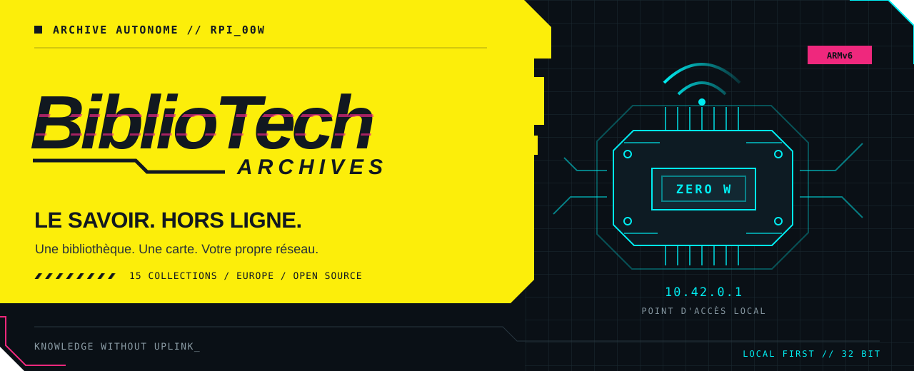
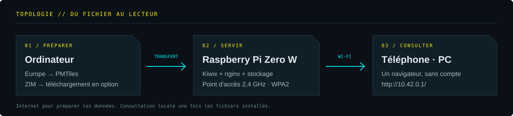

<p align="center">
  
</p>

<p align="center">
  <a href="docs/installation.md"><strong>Installer</strong></a> ·
  <a href="#collections">Explorer les collections</a> ·
  <a href="docs/validation.md">État des tests</a> ·
  <a href="CONTRIBUTING.md">Contribuer</a>
</p>

# BiblioTech

**Transformez un Raspberry Pi Zero W en bibliothèque Wi-Fi autonome.** Livres, encyclopédies, guides pratiques et carte interactive de l’Europe deviennent accessibles depuis un navigateur, sans connexion Internet pendant la consultation.

BiblioTech automatise l’installation du moteur Kiwix, configure le point d’accès et réunit les contenus dans un portail local. Les utilisateurs rejoignent votre Wi-Fi, puis ouvrent **http://10.42.0.1/**.

| Matériel cible | Bibliothèque | Carte | Licence du projet |
| :--- | :--- | :--- | :--- |
| **Pi Zero W · ARMv6 · 32 bits** | **15 collections · 98,11 Gio** | **Europe · hors ligne** | **[GPL-3.0](LICENSE)** |

> [!IMPORTANT]
> **État du projet : validation sur matériel à compléter.** Les tests logiciels passent et la conversion cartographique a été vérifiée sur Monaco. Le démarrage, le Wi-Fi et les performances doivent encore être testés sur un Pi Zero W réel. [Détails des vérifications →](docs/validation.md)

## 01 // Votre réseau de savoirs

| Fonction | Ce que fait le projet |
| :--- | :--- |
| **Bibliothèque Kiwix** | Installe les 15 éditions sélectionnées et construit leur index automatiquement. |
| **Téléchargements fiables** | Reprend les transferts interrompus, contrôle la taille et le SHA-256, puis ajoute les fichiers complets à la bibliothèque. |
| **Point d’accès Wi-Fi** | Configure NetworkManager en WPA2, sur la bande 2,4 GHz, avec DHCP et DNS locaux. |
| **Carte interactive** | Sert une carte vectorielle de l’Europe ; styles, scripts et polices sont également locaux. |
| **Portail nocturne** | Accueil inspiré de Blade Runner (1982), ville en ASCII, néons ambre et cyan, mise en page adaptée aux petits écrans. |
| **Démarrage automatique** | Lance les services au démarrage ; le Wi-Fi devient automatique après sa première activation. |
| **Maintenance accessible** | Fournit des commandes pour revenir au Wi-Fi habituel, réindexer les collections et consulter les journaux. |

<p align="center">
  
</p>

Le Pi héberge les fichiers ; les appareils des lecteurs affichent la carte. La conversion des données Geofabrik s’effectue sur un ordinateur disposant de davantage de mémoire. Les fichiers cartographiques sont proposés à côté de Kiwix dans le même portail, car ce ne sont pas des archives ZIM.

## 02 // Avant de démarrer

| Élément | Prérequis |
| :--- | :--- |
| **Raspberry Pi** | Zero W original, alimentation stable, Raspberry Pi OS **Lite 32 bits**, Trixie ou Bookworm, avec NetworkManager. |
| **Stockage** | **ext4 recommandé**. Les ZIM seuls occupent 98,11 Gio. Prévoir la carte, le système et une marge ; 256 Go constitue un point de départ à vérifier selon la carte produite. |
| **Ordinateur de préparation** | Système 64 bits, Java 21+, Python 3 et curl. Pour l’Europe, ordre de grandeur : **32 Go de RAM et 350 Go de SSD libre**. |
| **Connexion initiale** | Internet pour les paquets et les données ; Ethernet/USB ou téléchargement sur ordinateur conseillé pour les gros transferts. |
| **Appareils des lecteurs** | Un navigateur récent. WebGL est requis pour la carte. |

Le choix des paquets Raspberry Pi OS respecte la cible ARMv6. Les grandes collections et les lecteurs simultanés restent contraints par la mémoire du Zero W. Les éditions sont fixées dans le [manifeste](config/contents.json) ; elles ne sont jamais remplacées silencieusement.

## 03 // Mise en service

### Préparer la carte sur l’ordinateur

Depuis le dossier du projet :

```bash
./scripts/prepare-map.sh
```

Le résultat est `build/maps/europe.pmtiles`. Copier ensuite **le projet sur le Pi** et **la carte dans `/srv/bibliotech/maps/europe.pmtiles`**, en suivant le [guide de transfert](docs/installation.md#2-copier-le-projet-et-la-carte-sur-le-pi). Pour un autre emplacement, adapter `DATA_DIR` dans la configuration.

### Installer sur le Raspberry Pi

Après le transfert, depuis le dossier du projet sur le Pi :

```bash
cp config.example.env config.env
chmod 600 config.env
nano config.env
```

Définir `WIFI_PASSWORD` et vérifier `WIFI_COUNTRY`, puis lancer :

```bash
sudo ./install.sh
```

L’installateur récupère les 15 archives, vérifie leur intégrité et configure les services. Si les ZIM ont déjà été transférés depuis l’ordinateur, utiliser `sudo ./install.sh --no-download`. [Préparer les ZIM sur un ordinateur →](docs/installation.md#3-installer-sur-le-pi)

### Ouvrir le réseau

```bash
sudo bibliotech-hotspot on
```

La connexion Wi-Fi actuelle bascule **10 secondes plus tard**, ce qui peut interrompre SSH. Rejoindre le réseau **BiblioTech** avec votre mot de passe, accepter de rester connecté sans Internet, puis ouvrir **http://10.42.0.1/**.

**[Lire le guide complet d’installation et d’exploitation →](docs/installation.md)**


<a name="collections"></a>

## 04 // Les collections

La sélection rassemble littérature, savoirs pratiques et projets Wikimedia. Les tailles et empreintes ont été vérifiées le **17 octobre 2026** ; la disponibilité distante peut évoluer.

<details>
<summary><strong>Voir les 15 éditions exactes — 98,11 Gio au total</strong></summary>

| Collection | Édition | Taille |
| :--- | :--- | ---: |
| Gutenberg | `gutenberg_fr_all_2026-01` | 9,81 Gio |
| iFixit | `ifixit_fr_all_2026-03` | 3,40 Gio |
| Breizh Partitions | `breizhpartitions_fr_all_2026-02` | 5,27 Gio |
| Cuisine Libre | `cuisinelibre.org_fr_all_2026-08` | 0,24 Gio |
| Bouquineux | `bouquineux.com_fr_all_2025-12` | 5,54 Gio |
| Low-tech Magazine | `solar.lowtechmagazine.com_mul_all_2025-01` | 0,65 Gio |
| Solidarité Numérique | `www.solidarite-numerique.fr_fr_all_2025-11` | 0,20 Gio |
| Psiram | `psiram_fr_all_maxi_2026-08` | 0,28 Gio |
| Wikibooks | `wikibooks_fr_all_maxi_2026-10` | 1,07 Gio |
| Wikipédia | `wikipedia_fr_all_maxi_2026-05` | 51,63 Gio |
| Wikiquote | `wikiquote_fr_all_maxi_2026-08` | 0,11 Gio |
| Wikisource | `wikisource_fr_all_maxi_2025-09` | 14,60 Gio |
| Wikiversity | `wikiversity_fr_all_maxi_2026-08` | 0,47 Gio |
| Wikivoyage | `wikivoyage_fr_all_maxi_2026-07c` | 0,23 Gio |
| Wiktionary | `wiktionary_fr_all_nopic_2026-08` | 4,60 Gio |

Le suffixe `07c` de Wikivoyage est intentionnel. Les liens de téléchargement, tailles exactes et SHA-256 se trouvent dans [config/contents.json](config/contents.json).

</details>

```bash
python3 scripts/content.py plan          # Afficher les tailles, hors ligne
python3 scripts/content.py check-remote  # Vérifier les éditions sur le serveur
```

La carte Europe s’ajoute à cette sélection. Elle affiche les routes, villes, cours d’eau et bâtiments, avec des tuiles jusqu’au zoom 14. Elle ne calcule pas d’itinéraires et ne propose pas de recherche d’adresses.

## 05 // Exploitation et développement

```bash
sudo bibliotech-hotspot status   # État du réseau et des services
sudo bibliotech-hotspot off      # Retour au profil Wi-Fi précédent après 10 secondes
./tests/check.sh            # Vérifications locales, sans installer le serveur
```

La radio intégrée utilise un mode à la fois : Wi-Fi client ou point d’accès. Une liaison Ethernet/USB peut fournir un accès amont supplémentaire ; le mode partagé de NetworkManager le rend alors disponible aux clients. Le portail s’ouvre manuellement à son adresse HTTP.

| Documentation | Contenu |
| :--- | :--- |
| [Installation et exploitation](docs/installation.md) | Préparation, transfert, paramètres, maintenance et diagnostic. |
| [Validation](docs/validation.md) | Tests effectués, limites et essais à réaliser sur le Pi. |
| [Personnaliser le portail](docs/portal.md) | Identité visuelle, bannière ASCII et fichiers à modifier. |
| [Contribuer](CONTRIBUTING.md) | Environnement, vérifications et proposition de changements. |
| [Journal des changements](CHANGELOG.md) | Évolution du projet. |
| [Publication manuelle](docs/publishing.md) | Préparation du dépôt et commandes Git à exécuter vous-même. |

Le workflow [GitHub Actions](.github/workflows/ci.yml) exécute les vérifications sur Linux et macOS. Il ne télécharge aucune collection, ne génère pas la carte Europe et ne publie aucun artefact.

## 06 // Origines et licences

Ce projet adapte le guide **[RaynerMDZ/Kiwix-Raspberry-Pi](https://github.com/RaynerMDZ/Kiwix-Raspberry-Pi)** et s’appuie sur [Kiwix](https://kiwix.org/), [Geofabrik](https://download.geofabrik.de/europe.html), [Planetiler](https://github.com/onthegomap/planetiler), [OpenMapTiles](https://openmaptiles.org/), [PMTiles](https://docs.protomaps.com/) et [MapLibre](https://maplibre.org/).

Le code du projet est distribué sous **[GPL-3.0](LICENSE)**. Les archives ZIM, les données cartographiques, les polices et les bibliothèques conservent leurs propres licences. Les données OSM sont attribuées à **© OpenStreetMap contributors** ; le portail conserve également le crédit OpenMapTiles. [Détail des sources et licences →](docs/installation.md#sources-et-licences)

<p align="center">
  
  <br>
  <sub><strong>BIBLIOTECH</strong> · LOCAL FIRST · KNOWLEDGE WITHOUT UPLINK</sub>
</p>
